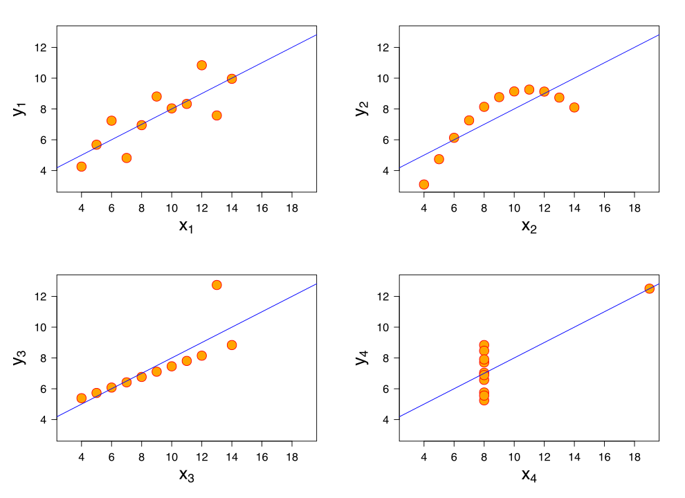

## Statistics is the science of $\ldots$
<br>

* distilling a lot of numbers into a few numbers.

# mean

## Just Average

* Why do we care about the mean?
	- Because computing it takes $O(n)$ time? (A median can also be selected in linear time.)
	- Tells us something useful?

* But when does it tell us something useful?
	- When the question concerns an average or total; symmetry is not required
	- As a description of a typical observation, when it is not dominated by a long tail

* When you show people the mean, that is what they picture

* If we present it as typical when it is not
	- We can mislead people

* The fixes are obvious
	- Show a different number, e.g., median
	- Or, perhaps, one number is not enough. Show different percentiles?

## Lesson

* Formulas tell us something useful to the extent the assumptions hold
* Know the assumptions behind the formulas.

## Far From the Mean

* How far away is a point from the mean?
	- $(x - \bar{x})$

* How far away from the mean are points on average?
	- Let's say there are $n$ points
	- $\frac{\Sigma_1^n (x - \bar{x})}{n}$
	- Always equals zero, apart from rounding; it tells us neither symmetry nor spread

* One measure of spread is the mean squared deviation (denominator $n$)
	- For an unbiased estimate of population variance from an iid sample, use $n-1$ instead
	- $\frac{\Sigma_1^n (x - \bar{x})^2}{n}$

* But why squares?
	- Add 2 units to 2, 12 units to 4. Why?

##

* Ok. We will take a square root.
	- $\sqrt{\frac{\Sigma_1^n (x - \bar{x})^2}{n}}$

* But the square root of the sum of squares is not the same as the average absolute value


``` r
sqrt(sum((seq(1, 5, 1) - 3)^2)/5)
```

```
## [1] 1.414214
```

``` r
sum(abs(seq(1, 5, 1) - 3)/5)
```

```
## [1] 1.2
```

# go together

## Meaning

* When $x$ is large, is $y$ large too?

* When $x$ is 1, is $y$ more likely to be 1 than when $x$ is 0?

* When $x$ is larger, is $y$ is larger too?
	* Restatement: As $x$ increases, does $y$ increase too?
	* On average

* Fraction of adjacent pairs where both variables increase (not Pearson correlation)

``` r
x = c(100, 200, 300, 400, 500, 600)
y = c(1, 2, 3, 4, 5, -17000)
mean(diff(x) > 0 & diff(y) > 0)
```

```
## [1] 0.8
```

## Dummy Correlation

* When $x$ is above average, $y$ is above average
	- Dichotomize. Quadrant Count Ratio.

* Continuous version:
	- $\Sigma_1^n (x - \bar{x}) (y - \bar{y})$
	- If you are below the mean, I am below the mean, a positive number

* Let's try this out.
	- 100, 200, 300, 400, 500
	- 1, 2, 3, 4, 5


``` r
x = seq(100, 500, 100) - 300
y = seq(1, 5, 1) - 3
num = sum(x*y)
num
```

```
## [1] 1000
```

## Normalize

* Normalizing constant
	- $\sqrt{\Sigma_1^n (x - \bar{x})^2 \Sigma_1^n (y - \bar{y})^2}$
	- Requires nonzero variation in both variables; equivalent to averaging products of consistently standardized scores
	-

``` r
x = sum((seq(100, 500, 100) - 300)^2)
y = sum((seq(1, 5, 1) - 3)^2)
den = sqrt(x*y)
den
```

```
## [1] 1000
```
	- Correlation:

``` r
num/den
```

```
## [1] 1
```

## Centering matters

* What if we subtract 100 and 1 instead of the means?
* The resulting normalized dot product is not generally Pearson correlation. This perfectly linear example happens to give 1 either way.


``` r
x = seq(100, 500, 100) - 100
y = seq(1, 5, 1) - 1
sum(x*y)
```

```
## [1] 3000
```


``` r
x = sum((seq(100, 500, 100) - 100)^2)
y = sum((seq(1, 5, 1) - 1)^2)
sqrt(x*y)
```

```
## [1] 3000
```

## Linear Relation

* Let's add a big jump

``` r
x = c(100, 200, 300, 400, 500, 600)
y = c(1, 2, 3, 4, 5, 17000)
```


``` r
cor(x[1:5], y[1:5])
```

```
## [1] 1
```


``` r
cor(x, y)
```

```
## [1] 0.6548077
```

## Linear Relation

* Let's add a big drop

``` r
x = c(100, 200, 300, 400, 500, 600)
y = c(1, 2, 3, 4, 5, -17000)
```


``` r
cor(x, y)
```

```
## [1] -0.6544996
```

## Rank

* Same order?

``` r
x = c(100, 200, 300, 400, 500, 600)
y = c(1, 2, 3, 4, 5, 17000)
cor(x, y, method = "spearman")
```

```
## [1] 1
```

| bangles | hoops   | delta_bangles | delta_hoops| rank_bangles | rank_hoops |
  |---------|---------|---------------|------------|--------------|------------|
  | 10      | 500     |  1            | 0          |   1          |      2     |
  | 9       | 500     |  1            | 0          |   2          |      2     |
  | 8       | 500     |  1            | 250        |   3          |      2     |
  | 7       | 250     |  1            | 50         |   4          |      4     |
  | 6       | 200     |  NA           | NA         |   5          |      5     |

* The table ranks from largest to smallest, averaging tied ranks; deltas are current minus next row.
* Rank $x$s and $y$s
	- Kendall's $\tau$ compares concordant and discordant pairs; $\tau_b$ adjusts for ties
	- Spearman's $\rho$ is Pearson correlation of the ranks, with average ranks for ties

## Anscombe's Quartet



## Lessons

* Pearson's correlation summarizes linear association; it can miss nonlinear patterns.
* Skewness does not make it undefined, but outliers can strongly affect it.
* Zero correlation does not imply independence.
* Sometimes you need more than one number to describe a relationship

# Linear Regression

## Intuitions

* Temperature and ice-cream sales
	- *same* temperature ($x=$ 40&deg;C) but sales vary (multiple $y$)

* What is a function?
	- For each $x$ there is just one $y$

* For the $same$ temperature:
	- predict the conditional mean under squared-error loss

* You have data on 40&deg;C and 41&deg;C but not 40.4&deg;C
	- Learn from your neighbors
	- Linear interpolation of means
	- $\hat{y}_{40.4} = .6\bar{y}_{40} + .4\bar{y}_{41}$

* Learning from neighbors even when you have data

* The population conditional mean minimizes expected squared error
	- A sample local mean estimates it and can be noisy
	- Other losses can have different optimal predictions

* With sparsity, multiple dimensions
	- Smoothness

## Linear Regression

* We assume that the function is linear
	- It is a line. $y = f(x) = a + b*x$

* But how we find the *best fitting* line?
	- But what does that mean?
	- Line that minimizes squared errors in $y$: $(y - \hat{y})^2$
	- But why do we care about squared errors?
	- Squared loss targets the conditional mean and penalizes large errors more heavily; Gaussian errors also give a likelihood justification

* But useful to check if linearity is a good assumption
	- Does it fit the data well?
	- Are the errors huge?
	- Are the errors huge in one place and small in other places?
