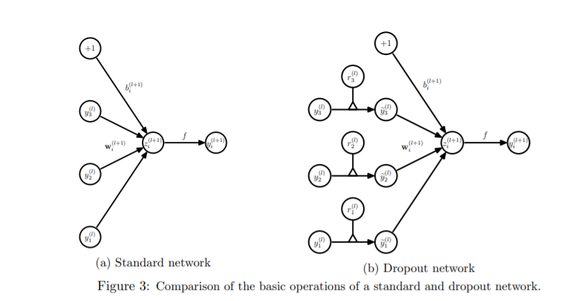
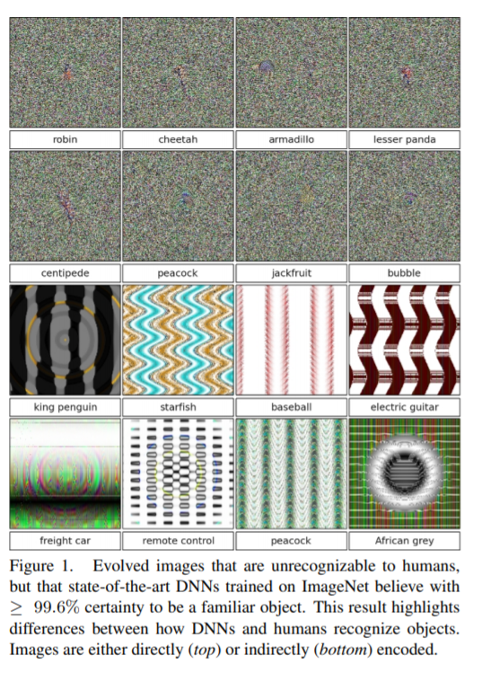
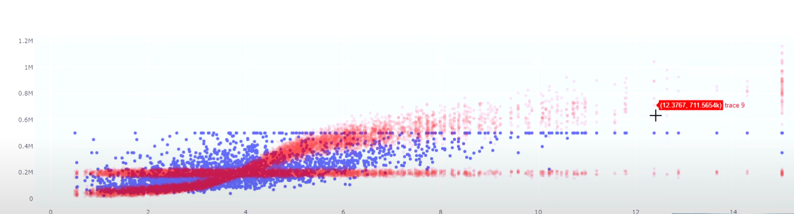

## Bias, variance, and error

* Fix a prediction point $x$. Let $Y=f(x)+\epsilon$, with $E[\epsilon\mid x]=0$ and $\operatorname{Var}(\epsilon\mid x)=\sigma^2(x)$.
* The fitted predictor $\hat f_D$ depends on a random training set $D$, independent of the new outcome's noise.
* Write $\mu(x)=E_D[\hat f_D(x)]$.
* $\operatorname{Bias}(x)=\mu(x)-f(x)$.
* $\operatorname{Var}_D(\hat f_D(x))=E_D[(\hat f_D(x)-\mu(x))^2]$.

## Decomposing squared error

* $Y-\hat f_D(x)=[f(x)-\mu(x)]+[\mu(x)-\hat f_D(x)]+\epsilon$.
* $(a+b+c)^2=a^2+b^2+c^2+2ab+2ac+2bc$.
* The cross terms have zero expectation: the centered fitted predictor and noise have mean zero, and training data and new noise are independent.
* Thus
  $$E_{D,\epsilon}[(Y-\hat f_D(x))^2\mid x]
  =\operatorname{Bias}(x)^2+\operatorname{Var}_D(\hat f_D(x))+\sigma^2(x).$$
* The noise term is conditional variance, not the marginal variance of $Y$.

## Bias/Variance Tradeoff

* kNN

  $E[(y- \hat{f}(x))^2| X=x]= (f(x) - \frac{1}{k} \sum_{i=1}^{k} f(N_{i}(x)))^{2} + \frac{\sigma^{2}}{k} + \sigma^{2}$

  where $N_1(x), ..., N_k(x)$ are fixed training inputs. This conditional calculation assumes independent training and test errors with common variance $\sigma^2$. Random neighbor locations contribute additional variation when we average over training inputs.

* Regression methods
    - Penalize large $\theta$s
    - Penalize squiggliness

* How to think?
  * Priors on $\theta$s, squiggliness, etc.
  * Constrained optimization

* Methods
  * Change the cost function
  * Add priors to thetas
  * [Add noise](https://direct.mit.edu/neco/article/7/1/108/5828/Training-with-Noise-is-Equivalent-to-Tikhonov)
  * Model averaging
  * Constrain weights---max-norm

## Cubic Spline Smoothing

* Spline = A spline of degree $k$ is piecewise polynomial, typically with $k-1$ continuous derivatives at simple knots. Some authors use order $k+1$ for degree $k$

* The second derivative measures how rapidly the slope changes
  - Integrate over the second derivative (squared)

* Math
  * Maximize a penalized log likelihood: $\log L-\lambda W$
  * Or minimize squared error plus a roughness penalty: $\sum_{i=1}^n(y_i-f(x_i))^2+\lambda\int(f^{''}(x))^2dx$

## Dropout

* Feed forward operation of standard NN for $l \in \{0, ..., L-1\}$ and hidden unit $i$ where $f$ is any activation function

  $z_i^{(l + 1)} = w_i^{(l + 1)} y^l + b_i^{(l + 1)}$ 
  $y_i^{(l + 1)} = f(z_i^{(l + 1)})$

* With Dropout:

  $r_j^{(l)} \sim \text{Bernoulli}(p)$ 
  $\tilde{y}^{(l)} = r^{(l)}*y^{(l)}$ 
  $z_i^{(l + 1)} = w_i^{(l + 1)} \tilde{y}^{(l)} + b_i^{(l + 1)}$ 
  $y_i^{(l + 1)} = f(z_i^{(l + 1)})$

* [Inverted Dropout](https://stats.stackexchange.com/questions/241645/how-to-explain-dropout-regularization-in-simple-terms/241668#241668)

* Backward propagation

## Dropout

## Dropout

* Heuristic understanding
  * Prevents network from co-adapting too much
  * Averaging over many models
    * Sample masks during training, often separately for each example
    * An approximate ensemble interpretation; shared weights do not give an exact average of independently trained networks

* Mathematical understanding
  * Gal and Ghahramani (2016)
  * Under specified assumptions, dropout admits a variational Bayesian interpretation related to a Gaussian process

## More Dropout

* Practical issues
  * Retention rates such as .8 for inputs and .5 for hidden units are starting points, not universal optima
  * Pair with max norm regularization
    * constrain the $L_2$ norm of the weight for each hidden unit to $c$
  * Prediction
    * For unscaled training masks, multiply outgoing weights by retention probability $p$ at test time. With inverted dropout, divide retained activations by $p$ during training and do no test-time scaling.

## The Importance of Being Uncertain

* Deep networks can be easily fooled

  

* Tesla

## How?

* Using Dropout to Estimate Uncertainty
  * Monte Carlo dropout: keep dropout active and pass the same input through the model repeatedly. Ordinary evaluation mode disables dropout. The variation is an approximate measure of model uncertainty, not automatically calibrated total predictive uncertainty.

## Figure

## Batch normalization

* During training, normalize activations using the mini-batch mean and variance, then apply learned scale and shift parameters.
* During standard inference, use running estimates collected during training. This supports prediction for a single example.
* Batch statistics add noise and can have a regularizing effect; the effect depends on batch size and the model.
* Batch normalization can improve optimization. It does not guarantee robustness to a changed input distribution.

## References

* [Srivastava et al. (2014), Dropout](https://jmlr.org/papers/v15/srivastava14a.html).
* [Gal and Ghahramani (2016), Dropout as a Bayesian Approximation](https://proceedings.mlr.press/v48/gal16.html).
* [Ioffe and Szegedy (2015), Batch Normalization](https://proceedings.mlr.press/v37/ioffe15.html).
* [Santurkar et al. (2018), How Does Batch Normalization Help Optimization?](https://arxiv.org/abs/1805.11604).
