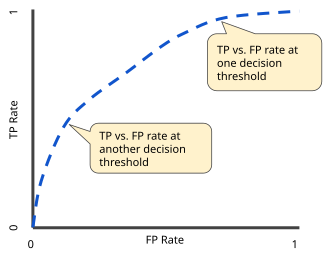
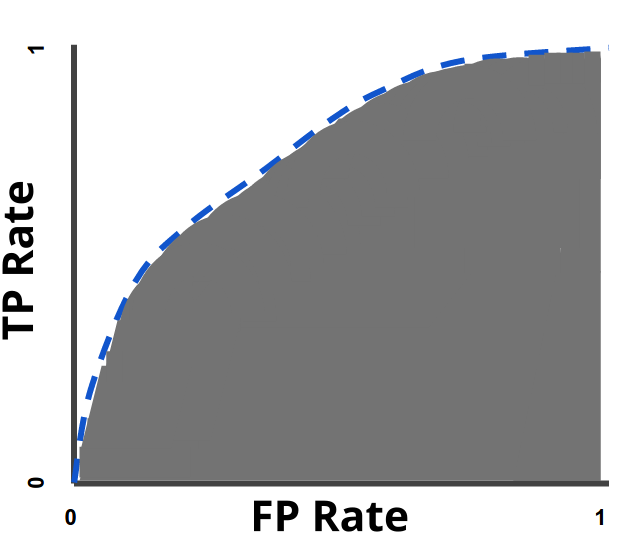

## ML Recipe

<ul>
<li class = "fragment"> Specify the quantity of interest</li>
<li class = "fragment"> Specify the cost function</li>
<li class = "fragment"> Find the lowest price on the market</li>
  <ul>
  <li class = "fragment"> Specify a model</li>
  <li class = "fragment"> Find the global optima</li>
  <ul>
    <li class = "fragment"> Validation set performance</li>
  </ul>
  <li class = "fragment"> Find the model with the best validation set performance</li>
</ul>

## OOS

* Rule: use validation data for model selection; keep the test set untouched until final evaluation

* Problem:
  * Say we want to choose the degree of polynomial but use test error to pick the model, we would have an optimistic assessment of its performance.

* Solution:
  * Train/Dev/Test

* How to construct OOS
  * Distribution:
    * Dev and test sets should reflect data you expect to get in the future
    * Dev and test sets should come from the same distribution

  * Size
    * Test set has to be big enough to give you a good estimate of the performance
    * 60/20/20 is an example split, not a rule; cross-validation can use limited training data more efficiently
    * 95/2.5/2.5 is another example; choose counts based on precision and dependence, not percentages alone

# Metrics

## Satisficing Metric and Optimizing Metric

* Satisficing metrics:
  * $\sim$ Constraints
  * Examples:
    * Maximize accuracy subject to running time $<= 100ms$
    * Alexa: Maximize accuracy subject to the constraint that false alarms are at most one per 24 hours (a rate per time, not the fraction of negatives classified positive)

* Regularization
  * MinDiff $\sim$ Equalize error rates across groups.
  * Source: <a href = "https://arxiv.org/pdf/1910.11779.pdf">Google; Prost et al. 2019</a>

## Measuring Performance

* RMSE
* MAE
* $R^2$
* Deviance
* AUC
* Accuracy
* ...

## $R^2$

* $SS_{\rm tot}=\sum_i(y_i-\bar y)^2$, $SS_{\rm res}=\sum_i(y_i-\hat y_i)^2$.
* $R^2=1-SS_{\rm res}/SS_{\rm tot}$, provided $SS_{\rm tot}>0$.
* In-sample OLS with an intercept:
  $R^2=\sum_i(\hat y_i-\bar y)^2/SS_{\rm tot}=\operatorname{cor}(y,\hat y)^2$ when the correlation is defined.
* These identities do not generally hold for arbitrary predictions or a test set.
* Test-set $R^2$ can be negative: prediction is worse than using that set's outcome mean.
* In-sample OLS $R^2$ cannot decrease when predictors are added on the same observations.

## Adjusted $R^2$ and nested models

* With $p$ predictors excluding the intercept:
  $\bar R^2=1-(1-R^2)(n-1)/(n-p-1)$, for $n>p+1$.
* For nested OLS models on the same observations, with $k_1<k_2$ parameters **including** the intercept:
  $$F=\frac{(RSS_1-RSS_2)/(k_2-k_1)}{RSS_2/(n-k_2)}.$$
* Under the smaller model and independent, homoskedastic Gaussian errors, this has an $F_{k_2-k_1,n-k_2}$ distribution.
* This is an in-sample model test. Use held-out prediction errors for out-of-sample comparisons.

## Deviance and information criteria

* Deviance compares fitted and saturated log likelihoods:
  $D=2(\ell_{\rm saturated}-\ell_{\rm fitted})$.
* One pseudo-$R^2$ is $1-D_{\rm fitted}/D_{\rm null}$ when $D_{\rm null}>0$. Pseudo-$R^2$ definitions differ.
* $AIC=-2\hat\ell+2k$; $BIC=-2\hat\ell+k\log n$.
* Count all estimated likelihood parameters in $k$, including a fitted variance parameter where applicable. Compare models fitted to the same response data with comparable likelihoods.

## Choosing a criterion

* AIC estimates relative expected predictive discrepancy under regularity conditions.
* For Gaussian regression, a common small-sample correction is
  $AIC_c=AIC+2k(k+1)/(n-k-1)$, requiring $n>k+1$.
* BIC penalizes additional parameters more heavily than AIC when $n>e^2$. This does not mean that it always underfits for large $n$.
* Neither criterion replaces checking model assumptions and held-out performance.
* [R documentation: AIC and BIC](https://stat.ethz.ch/R-manual/R-devel/library/stats/html/AIC.html).

## Confusion About Confusion Matrices

* Given model, produce confusion matrix
  * using the confusion matrix, calculate precision, recall, etc.

* This gets it backwards

* Most classification models output a continuous variable: estimated probability

* For the same model, you can build multiple decision rules that give different confusion matrices

## ROC

 
Source: Google

* For the same model,

## AUC

 
Source: Google

* Probability that a randomly chosen positive has a higher score than a randomly chosen negative, plus half the probability of a tie
  - Rank not euclidean distance

## Confusion Matrix

Pred --->

 &nbsp; | 0  | 1 |
--|----|---|
0 | TN | FP|
1 | FN | TP|

## Metrics

* Accuracy:   $\frac{TP + TN}{TP + TN + FP + FN}$

* Sensitivity, TPR: $\frac{TP}{TP + FN}$
* Specificity, TNR: $\frac{TN}{FP + TN}$
* FPR: $\frac{FP}{FP+TN}=1-\mathrm{specificity}$

* Precision: fraction of retrieved instances that are relevant 
             $\frac{TP}{TP + FP}$

* Recall: fraction of relevant instances that are retrieved 
               $\frac{TP}{TP + FN}$

## Quiz for Comprehension

 &nbsp; | 0  | 1 |
--|----|---|
0 | 78 | 10|
1 | 7  | 5 |

## Answers

* Accuracy = 83%
* Precision = 33.3%
* Recall = 41.7%
* F1 Score = 37.0%

## Dealing with Skew

* Track precision and recall
* $F_1$:
  * harmonic mean
    - $\frac{2}{\frac{1}{p} + \frac{1}{r}}$
  * $2\frac{\text{precision*recall}}{\text{precision + recall}}$
* $F_\beta$:
  * $\beta$ captures how important recall is vis-a-vis precision
  * $(1 + \beta^2) \frac{\text{precision*recall}}{\beta^2\text{precision + recall}}$

## Diagnosing Bias/Variance

* Bias problem (underfitting):
  * train error is high.
  * validation error is also high. Compare both against a meaningful baseline; noise, optimization failures, and distribution shifts can also produce high error.

* Variance problem (overfitting):
  * train error is low.
  * validation error is much higher than training error. This suggests overfitting, but also check for distribution shift and leakage.
    * Get more data
    * Regularization
