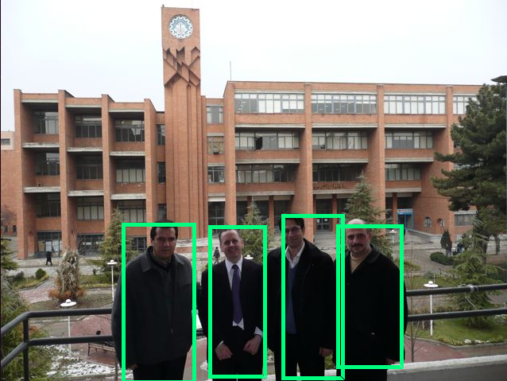
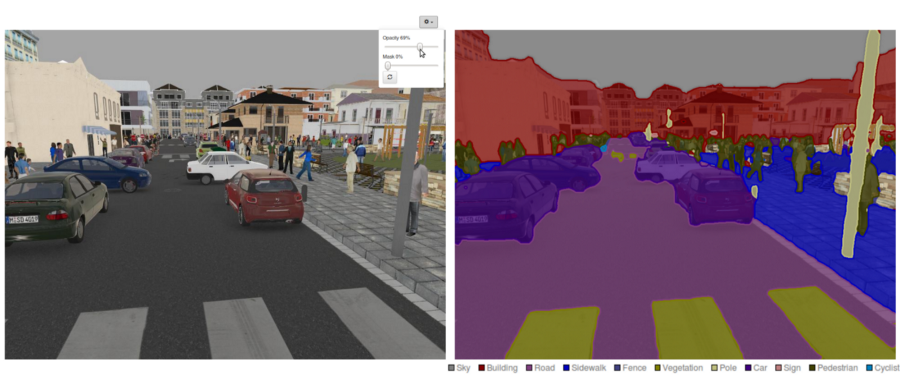
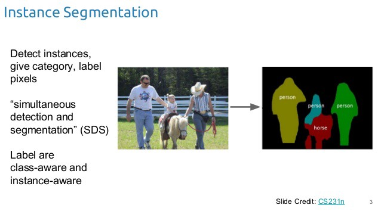
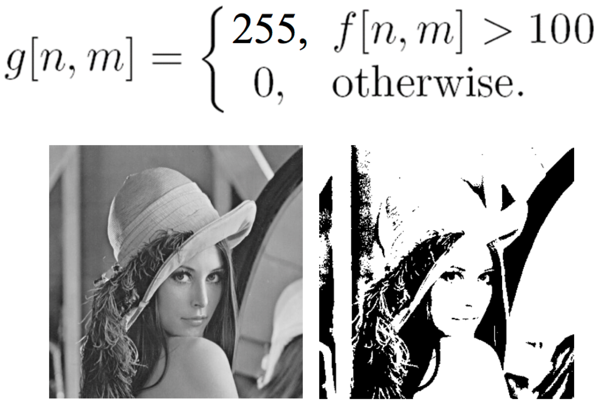
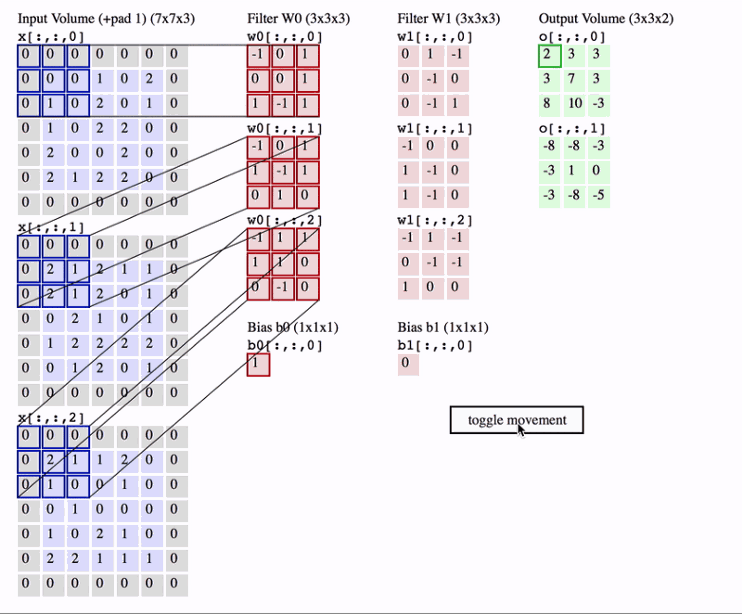
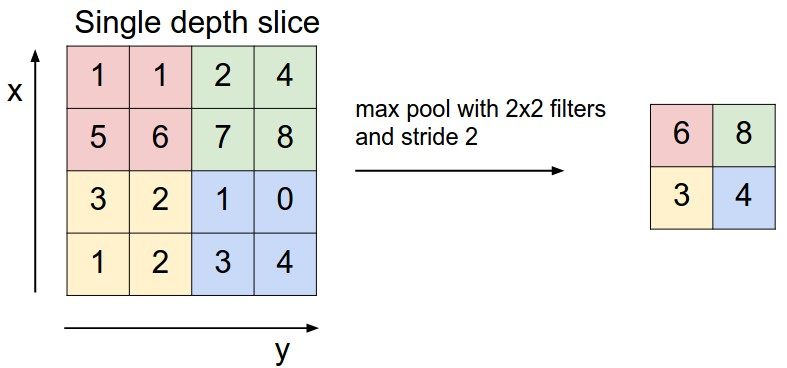
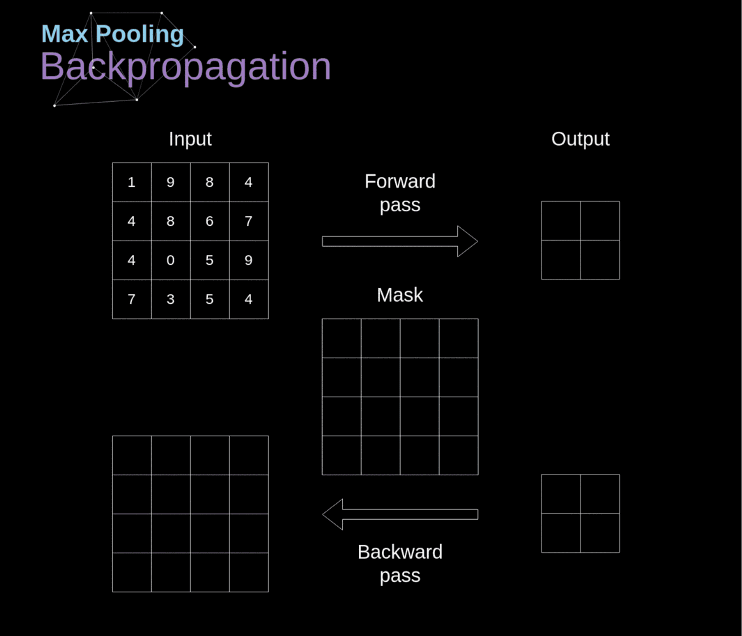
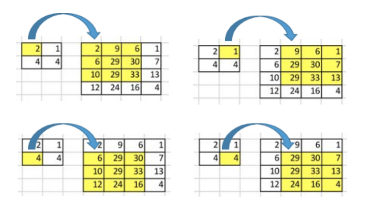
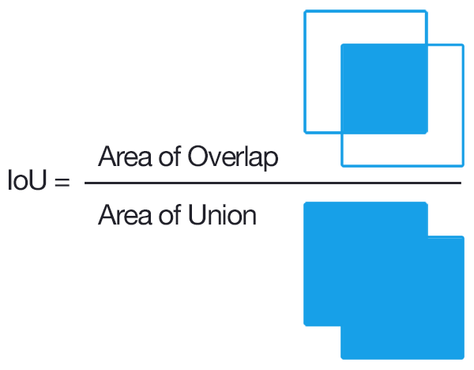
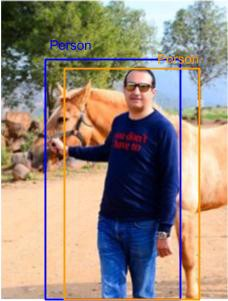

## Building Blocks and Main Varietals

* Building Blocks
  * Convolutions (Filters)
  * Pooling
  * Upsampling
  * Selective search

* Main Varietals
  * Object Detection
  * Image Segmentation
  * Instance Segmentation

## Object Detection

## Semantic Segmentation

## Instance Segmentation

## Why Do Instance Segmentation?

* Driving: is the car ahead braking?
  * To answer that, you need to track the car so that you can estimate change in speed
      * If you lose which car, your estimate of change in speed would be garbled
  * Instance segmentation can distinguish vehicles within a frame; tracking associates them across frames.

## A Brief Aside: How to build generalizable models?

* Classification
  * Inter-class variation
    * Cat images, Dog images
  * Intra-class variation:
      * How many different types of cats exist
  * Lots of diff. classes
    * It can encourage richer representations, but does not prevent shortcut learning

## Loss Function for Object Detection

* Localization Loss
  * Bounding box
  * (x, y), width, height
  * Coordinate convention depends on the detector. YOLO v1 predicts box centers relative to their grid cell and width/height relative to the image.
  * Loss function:
      * $(x - \hat{x})^2$, $(y - \hat{y})^2$
      * $(\sqrt{w} - \sqrt{\hat{w}})^2$ (YOLO)
        * to reduce the relative influence of large-box size errors on localization loss

* Classification Loss

* Net Loss
  * Localization Loss + Objectness Loss + Classification Loss
  * You can weight the losses

## YOLO v1 loss

For $S^2$ cells and $B$ boxes per cell, let $I_{ij}$ indicate the box responsible for a ground-truth object and $I_i$ indicate an occupied cell. Hats denote predictions. For a responsible box, $C_{ij}$ is its IoU with the ground-truth box; non-responsible boxes have target 0.

$$L=\lambda_{\rm coord}L_{\rm loc}
+L_{\rm conf}+L_{\rm cls}.$$

$$L_{\rm loc}=\sum_{i=1}^{S^2}\sum_{j=1}^{B}I_{ij}
\left[(x_{ij}-\hat x_{ij})^2+(y_{ij}-\hat y_{ij})^2
+(\sqrt{w_{ij}}-\sqrt{\hat w_{ij}})^2
+(\sqrt{h_{ij}}-\sqrt{\hat h_{ij}})^2\right].$$

## YOLO v1: confidence and classes

$$L_{\rm conf}=\sum_{i=1}^{S^2}\sum_{j=1}^{B}
[I_{ij}+\lambda_{\rm noobj}(1-I_{ij})](C_{ij}-\hat C_{ij})^2.$$

$$L_{\rm cls}=\sum_{i=1}^{S^2}I_i\sum_{c\in\mathrm{classes}}
[p_i(c)-\hat p_i(c)]^2.$$

Here $p_i(c)$ is the conditional class probability for an occupied cell. This is the YOLO v1 loss. See [Redmon et al. (2016)](https://www.cv-foundation.org/openaccess/content_cvpr_2016/papers/Redmon_You_Only_Look_CVPR_2016_paper.pdf).

## Segmenting Images

## Filters

A sharpening kernel (applied once):
$$\begin{bmatrix}0&-1&0\\-1&5&-1\\0&-1&0\end{bmatrix}.$$

## Convolutions

Slide a kernel over the image and sum element-wise products in each window. CNN libraries usually implement cross-correlation; mathematical convolution also flips the kernel.

##

{width=80%}

## (Max) Pooling

* Backward pass?

## Backward pass

## Upsampling

* Nearest neighbor interpolation
* Bi-linear interpolation, etc.

  \begin{align}
  f(x,y_{1}) \approx \frac{x_{2}-x}{x_{2}-x_{1}} f(Q_{11}) + \frac{x-x_{1}}{x_{2}-x_{1}} f(Q_{21})\\
  f(x,y_{2}) \approx \frac{x_{2}-x}{x_{2}-x_{1}} f(Q_{12}) + \frac{x-x_{1}}{x_{2}-x_{1}} f(Q_{22})
  \end{align}

  Next, interpolate in the y-direction:

  \begin{align}
   f(x,y) \approx \frac{y_{2}-y}{y_{2}-y_{1}} f(x,y_{1}) + \frac {y-y_{1}}{y_{2}-y_{1}} f(x,y_{2})
   \end{align}

## Transposed Convolution

## Evaluation Criteria

## Thresholding IoU

## Mean average precision

* Rank detections by confidence within each class.
* At a stated IoU threshold, match predictions to ground-truth boxes one-to-one; duplicate detections are false positives.
* Vary the confidence threshold to obtain a precision-recall curve.
* Average precision (AP) summarizes precision across recall levels; interpolation rules depend on the benchmark.
* Mean AP averages AP over classes. COCO also averages across specified IoU thresholds; report the benchmark convention.
* AP may be reported in [0, 1] or as a percentage.

## Segmenting Images

* Image as graph:
  * pixel = vertex
  * edge = connection between neighboring pixels
    - At most 8 neighboring pixels in an 8-connected grid
    - weight = dissimilarity between the pixels

* Measuring Distances
  * Internal Difference: $Int(C) = \max_{e\in MST(C, E)} w(e)$
  * Difference between two components: $Dif(C_1, C_2) = \min_{v_i \in C_1, v_j \in C_2, (v_i, v_j) \in E} w(v_i, v_j)$
  * Minimum internal difference: $MInt(C_1,C_2)=\min(Int(C_1)+\tau(C_1),Int(C_2)+\tau(C_2))$ where
    $\tau(C)=k/|C|$, with scale parameter $k\geq0$.

For a singleton, $Int(C)=0$. If no edge joins two components, their difference is infinite.

## Segmenting Images (Contd.)

* Segmentation
  * Partition vertices into multiple connected components
  * Evidence for a boundary between two components if
    $D(C_1, C_2) =
    \begin{cases}
      \text{True} & \text{ if } Dif(C_1, C_2) > MInt(C_1, C_2) \\
      \text{False} & \text{ otherwise}
    \end{cases}$

* [Felzenszwalb's Algorithm](https://cs.brown.edu/people/pfelzens/papers/seg-ijcv.pdf)
  * Sort edges by weight in ascending order
  * Start with n components
  * Pick the kth edge
  * If the vertices at the ends of the edge are in the same component, do nothing
  * If they are different, merge if $w(v_i, v_j) \leq MInt(C_i^{k-1}, C_j^{k-1})$

## Selective Search

1. Segment images

2. Greedily group regions together till all image is one region
    * Calculate similarity with neighbors
    * Combine with the most similar region
    * Calculate new similarity scores

3. Practical stuff:
  * Define similarity via color, texture, shape, etc.
  * Bias for merging smaller regions first.
