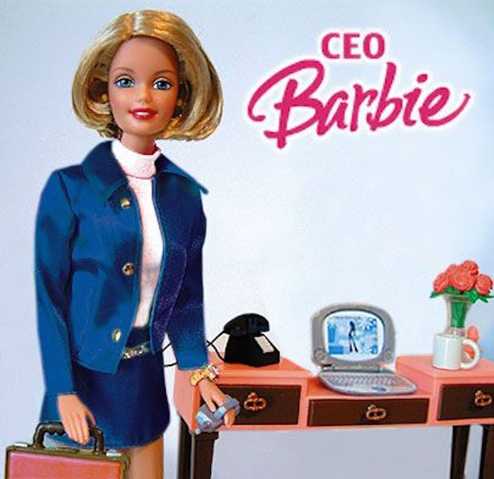

# ethical ml

## Concerns

* Solving bad problems with ML
  - DeepNude: Using DL to undress women
  - ML for password cracking

* Standard ML being used for bad aims
  - Face ID for finding political opponents

* Harm from violating privacy
  * Share data on health, etc., which may be used to discriminate
  * Inadvertent disclosures due to poor security

* Representational Harm
  - [CEO Barbie](https://www.washingtonpost.com/news/wonk/wp/2015/04/14/what-one-simple-google-search-tells-us-about-how-we-view-working-women/)

## CEO Barbie

{width=40%}

* In a 2015 study, 11% of the sampled CEO image-search results depicted women, compared with the study's 27% occupational benchmark. These are historical measurements, not current search statistics.
* [Unequal Representation and Gender Stereotypes in Image Search Results for Occupations](https://dl.acm.org/doi/abs/10.1145/2702123.2702520) (Kay, Matuszek, and Munson 2015)

## Taxonomy

* Unfair allocations
  - Interview panel has been making decisions about who gets in based on whether the person plays lacrosse
    - crack team of ML algo. people learn a model

* [Taxonomy](https://www.youtube.com/watch?v=fMym_BKWQzk) (Crawford NeurIPS, 2017; Barocas et al. 2017)
  - Representational Harm
  - Allocative Harm

## Underlying Reasons

* Training data can reflect unequal representation, selection, or measurement
  - CEO Barbie
    + captures societal biases
  - Hiring

* An unweighted aggregate loss gives more influence to groups with more observations
  - Good average performance can conceal poor performance for a smaller group

* Observed base rates can differ across groups
  - Such differences do not, by themselves, establish intrinsic causes; consider measurement, selection, and social conditions

## What's Fair?

* Fairness:
  * Who gets a loan and who doesn't
  * Even perfect prediction of a recorded label does not settle whether that label, decision, or allocation is fair
  * Misclassifications

## Group fairness

* Specify the rate and its denominator:
  * Accuracy conditions on group membership.
  * False-positive rate: $P(\hat Y=1\mid Y=0,G=g)$.
  * True-positive rate: $P(\hat Y=1\mid Y=1,G=g)$.
* Equal overall error rates do not imply equal false-positive or false-negative rates.
* Equalized odds requires equal FPR and TPR across groups. Equal opportunity requires equal TPR.
* A group-independent coin flip can satisfy some parity criteria while making poor decisions. No one metric settles fairness.
* Measurement matters: which groups, which labels, and whose harms?

## Solutions

* Anti-classification
  - Omit sensitive attributes, but recognize that other features can act as proxies; omission alone does not ensure fairness

* Calibration

* Classification Parity
  * via constrained optimization
    - constraint: group error rates are the same
    - When we are doing param. search, our search space is restricted
    - satisficing vs. optimizing metric
        - constraint = satisficing metric
  * via multi-objective optimization
    - pareto frontier
      - solutions where no specified objective can improve without worsening another specified objective
  * Weight examples from underrepresented groups when appropriate; outcome classes and demographic groups are different
  * Train separate models for different groups

## Trade-offs

* Equalizing one error metric may worsen another; compare the actual false positives, false negatives, and consequences for each group.
* Example: moving from 10 and 5 errors per 100 people to 20 and 20 equalizes overall error while harming both groups.
* A parity constraint is a mathematical requirement, not a complete definition of fair treatment.
* With different base rates, calibration and equalized error rates generally conflict except in special cases such as perfect prediction.

## Lender's perspective

* Classification error alone does not determine interest rates or loan access.
* Consequences depend on who is wrongly denied, who receives an unaffordable loan, default losses, decision thresholds, and market conditions.
* Evaluate the chosen policy's outcomes for applicants as well as lenders.
* Predictions describe risks under the observed process; changing lending policy can change who receives a loan and which outcomes are observed.

## Uncertain

* Discriminating against people where we are most uncertain
  * wider confidence bands for members in group x vs. group y on average
  * wide confidence bands mean
    * the estimated probability is imprecise; a wide interval does not by itself imply bias
      * uncertainty about the estimated probability is distinct from the randomness of an individual outcome

* Solution
  * if confidence_bands are big:
    * collect more data or compensate in another way

## Reference

* [Barocas, Hardt, and Narayanan, Fairness and Machine Learning](https://fairmlbook.org/), especially classification and causality.
