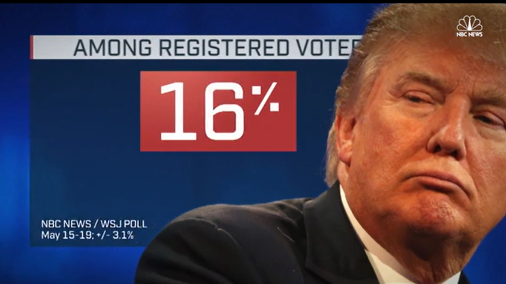
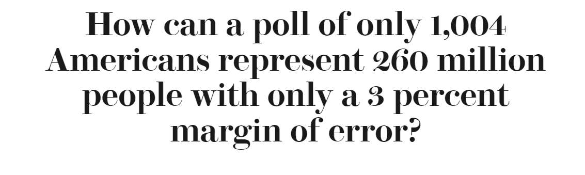

# Power Tools

## Think About Numbers

## Law of Large Numbers

* Life before Big Query

* How did we know?

##

##

## Magic

* Random sample
	- 100 people
	- another 100 people
	- their means will generally differ because of sampling variation
	- how about 1000 people?
	- less different
	- for independent Bernoulli samples, the sample proportion has standard deviation
		+ $\sqrt \frac{p*(1 -p)}{n}$
		+ maximize this given $n$
		+ also called the standard error; a normal approximation needs enough expected successes and failures

##

[Video example](https://www.youtube.com/watch?v=Kq7e6cj2nDw)

## MECE

* Management consultants swear by it, so it can't be a good idea. Right?
* Mutually Exclusive, Collectively Exhaustive
* Sample Failures
	* Assign 'type' of failure

## Doordash

* Say that they are having trouble giving good ETAs
	- Pre-pickup
		- cooking times
	- Post-pickup
		- 5 miles
			- average error +/- 30 minutes
				- when you have good location data
					- your estimates are still bad
					- under good conditions, how often do you fail?
						- dasher is close
						- dasher has good location data
						- what's the excuse?

## Systemic Thinking

* Sources of the problem
	- Meta failure
	- Localized failure
		+ Browser
		+ OS

## Exploit the Skew

* There would be no startups if:
	- each problem = lots of small ROI issues

* Pareto distribution
	- 80--20 rule
	- For a Pareto model, $P(X>x_2\mid X>x_1)=(x_1/x_2)^\alpha$ for $x_2\geq x_1\geq x_{\min}$
	- Under an exact Pareto income model with finite mean, a top-20% share of 80% implies a top-4% share of 64%. The first share alone does not imply the second without the distributional assumption.
	- At nearly each stage of problem solving, asymmetric returns

## Dr. House

* Differential Diagnosis
* Do something
	- If it fixes things...
